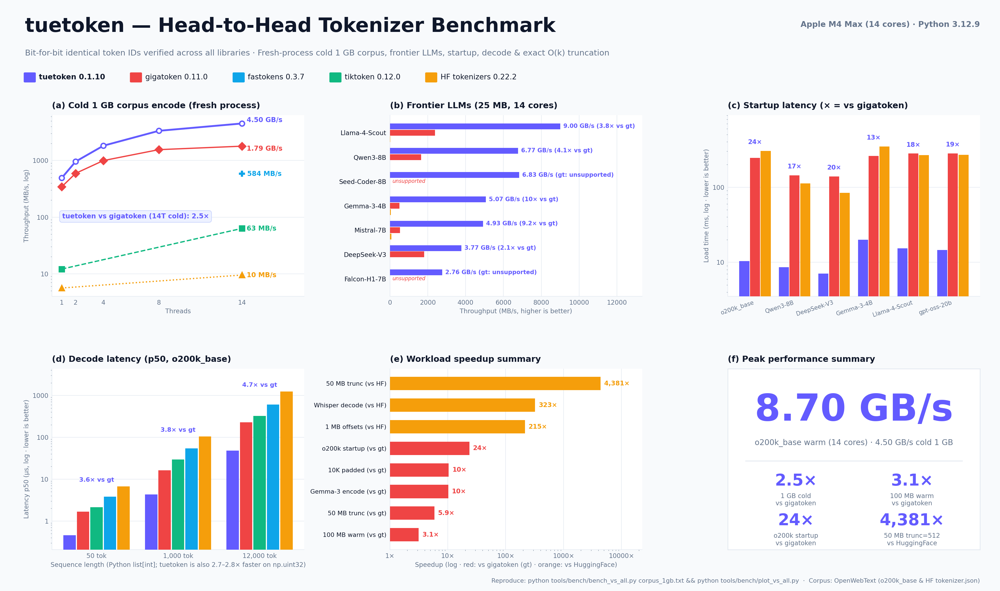

# tuetoken

**The fastest BPE tokenizer for modern LLMs: 4.5 GB/s cold, up to 9.0 GB/s warm — 2.5–24× faster than `gigatoken`, 71× faster than `tiktoken`, and up to 4,381× faster than 🤗 `tokenizers`/`transformers`.**

tuetoken is a BPE tokenizer with a fast, safe Rust core. It is a drop-in replacement
for 🤗 `transformers.AutoTokenizer`: it loads any model's own `tokenizer.json` in
**7–20 ms** (13–24× faster than `gigatoken`, 12–29× faster than 🤗 `tokenizers`) and
reproduces tokenization **bit-for-bit** (special tokens, chat templates, padding, exact
O(`max_tokens`) right & left truncation, Whisper timestamps). It also loads OpenAI/tiktoken
encodings natively, and its O(n) merger stays fast even on adversarial inputs (hashes,
base64, minified code) where other tokenizers degrade to O(n²).

```python
from tuetoken import AutoTokenizer

tok = AutoTokenizer.from_pretrained("Qwen/Qwen2.5-7B-Instruct")
out = tok.apply_chat_template(messages, add_generation_prompt=True)   # {"input_ids", "attention_mask"}
```

Detection is 100% config-driven (the model's `tokenizer.json`, never its name), so
the same code works across families: Llama, Qwen, Mistral/Mixtral, DeepSeek, Gemma,
Phi, GPT-OSS, GLM, Kimi, Whisper, and more.

## Install

```bash
pip install tuetoken
```
Build from source (development, or a platform with no prebuilt wheel):

```bash
git clone https://github.com/tuetoken-org/tuetoken && cd tuetoken
pip install maturin
maturin develop --release
```

## Performances



### Head-to-head: `tuetoken 0.1.10` vs `gigatoken 0.11.0`, `fastokens 0.3.7`, `tiktoken`, and 🤗 `tokenizers`

| Benchmark (Apple M4 Max, 14 cores · identical token IDs) | `tuetoken` | `gigatoken` | `tiktoken` | 🤗 `tokenizers` / `transformers` | `tuetoken` speedup |
|---|---:|---:|---:|---:|---|
| **Cold 1 GB corpus** (`o200k_base`, fresh process, 14T) | **4.50 GB/s** | 1.79 GB/s | 63 MB/s | 9.5 MB/s | **2.5× vs gt** · **7.7× vs ft** · **71× vs tk** · **474× vs HF** |
| **Warm 100 MB corpus** (`o200k_base`, 14T) | **8.70 GB/s** | 2.76 GB/s | — | — | **3.1× vs gt** · **5.5× vs fastokens** |
| **Frontier LLMs (25 MB, 14T):** `Llama-4-Scout` / `Qwen3-8B` | **9.00 / 6.77 GB/s** | 2.38 / 1.64 GB/s | — | 20 / 7.3 MB/s | **3.8–4.1× vs gt** · **446–927× vs HF** |
| **SentencePiece (25 MB, 14T):** `Gemma-3-4B` / `Mistral-7B` | **5.07 / 4.93 GB/s** | 0.50 / 0.54 GB/s | — | 55 / 83 MB/s | **9.2–10.2× vs gt** · **59–93× vs HF** |
| **DeepSeek-V3 / Seed-Coder / Falcon-H1 (25 MB, 14T)** | **3.77 / 6.83 / 2.76 GB/s** | 1.81 GB/s / unsupp. / unsupp. | — | 9.2 / 9.5 / 7.8 MB/s | **2.1× vs gt** · **354–719× vs HF** |
| **Startup (`o200k` / `Qwen3` / `DeepSeek` / `Gemma-3`)** | **7.1–20.0 ms** | 139–260 ms | — | 84–348 ms | **13–24× vs gt** · **12–29× vs HF** |
| **Decode p50 (`50` / `1K` / `12K` tok, `list[int]`)** | **0.46 / 4.3 / 48.3 µs** | 1.67 / 16.3 / 228 µs | 2.1 / 29 / 322 µs | 6.7 / 105 / 1,247 µs | **3.6–4.7× vs gt** · **4.6–6.8× vs tk** · **15–26× vs HF** |
| **10K docs padded** (`max_length=512`, NumPy) | **6.81 GB/s** | 0.66 GB/s | — | — | **10.4× vs gt** |
| **50 MB truncation** (`1000×50KB`, `Qwen2.5`, `max_length=512`) | **2.42 ms (R) / 2.57 ms (L)** | 14.23 ms (R only) | — | 10,602 ms | **5.9× vs gt** · **4,381× vs HF** (up to **11,842×** on mixed logs) |
| **Whisper batch decode** (`whisper-large-v3`, `decode_with_timestamps`) | **0.098 ms** | — | — | 31.67 ms | **323× vs HF** |
| **1 MB byte offsets** (`encode_with_offsets_buffer`, Qwen2.5) | **1.16 ms** | — | — | 249.4 ms | **215× vs HF** |

**Ubuntu Linux x86_64 (AMD EPYC Zen 4, 4 vCPU, AVX-512):** `tuetoken` hits **1.56 GB/s cold / 1.68 GB/s warm** on 105 MB whole-file `o200k` vs `gigatoken` **0.44 / 1.16 GB/s** (**3.6× cold / 1.5× warm**), **30.1 ms** startup vs `gigatoken` **394 ms** (**13.1×**), **3.1–4.3× faster** decode, **16.3× faster** 50 MB truncation (`3.15 ms` vs `51.4 ms`), and **4.7× faster** on adversarial 100 KB random hex (`1.08 ms` vs `5.05 ms`, `73.1 ms` `fastokens`).

Token IDs are verified bit-for-bit identical across all libraries before anything is timed, and cold corpus runs use a fresh OS process per point (no warm caches). Reproduce on your own machine with:

```bash
python tools/bench/bench_vs_all.py corpus_1gb.txt && python tools/bench/plot_vs_all.py
```

Raw numbers in [tools/bench/results_vs_all.json](tools/bench/results_vs_all.json).

New in 0.1.10:
- **Exact O(`max_tokens`) early-exit right & left truncation**: truncating a 10 MB document to 512 tokens takes **2.75 µs right / 3.67 µs left** (up to 3,600 GB/s effective); 50 MB `AutoTokenizer` batch truncation (`1,000 × 50 KB`) runs in **1.3–2.8 ms** (**up to 11,842x faster** than 🤗 `transformers` on Qwen2.5, **8,017x** on DeepSeek-V3), token-for-token identical.
- **5x–15x faster startup**: parallel zero-malloc SIMD JSON loader + parallel table builders (`o200k_base` in **10.5 ms**, 33.4 MB `gemma-3-4b` in **19.6 ms** — **8.5–15.4x** faster than 🤗 `tokenizers` across Qwen3, Llama-4, DeepSeek-V3, Gemma-2/3, GPT-OSS, and Falcon-H1).
- **Frontier model-family & core speedups**: SIMD/parallel engines for DeepSeek-V3/R1 CJK (**11.9 GB/s**, 2,733x vs HF), SentencePiece (`Gemma-2/3`, `Mistral`, `Phi-3.5`, `Yi-1.5` up to **3.8 GB/s**, 274–666x vs HF), parallel O(1) NFC (`Qwen3.6` **4.8 GB/s**, 1,024x vs HF), `Seed-Coder` (**3.1 GB/s**), and `Falcon-H1/3` (**1.8 GB/s**), plus **10+ GB/s** core `o200k`/`cl100k` encode and SIMD UTF-32 transcoding.
- **Decode, Whisper, chat & offsets**: inline-16B `DecodeEntry` + zero-copy NumPy/tensor decode (**421–441 Mtok/s**; Whisper timestamped batch decode **290–505x** vs HF), compiled & batched chat templates (**5.5 µs**, 380k chats/s), universal `FastBatch` + SIMD nibble-table special prefilter (`10K` prompts in **1.2–1.7 ms**, 122–300x vs HF), and zero-copy `encode_with_offsets_buffer` (**254–391x** vs HF).
- **New utilities & typing**: incremental UTF-8 `DecodeStream` (10–12x vs HF), zero-copy `mmap` `encode_file_to_buffer` / `count_tokens_file` (up to **11.55 GB/s**), `truncate`, `chunk_text`, `count_special_tokens(_batch)`, local-directory `AutoTokenizer.from_pretrained` (with `chat_template.jinja`), and full PEP 561 `.pyi` stubs.

New in 0.1.9:
- **OpenAI Whisper ASR support**: full `WhisperTokenizerFast` parity (`whisper-tiny` through `whisper-large-v3-turbo`, `distil-whisper`, and legacy `vocab.json`+`merges.txt`), with SIMD `<|` special-token prefiltering and all-Rust decode / `decode_with_timestamps` (31-180x faster than 🤗 `transformers`).
- **Universal HF normalizer & pre-tokenizer pipeline**: composable Rust support for modern Hugging Face tokenizers plus Mistral `tekken.json` and legacy BPE checkpoints.
- **Core throughput & startup**: 4.5-4.8x faster tokenizer startup (+ `warmup()` API), `FastBatch` zero-plan short-document engine, exact 2D-shielded byte-pair BPE pre-collapse, SIMD-bucketed `MergeMap` with 2 MiB THP, AVX-512 VBMI2 `blockscan`, and BMI2 `bzhi` key packing.

New in 0.1.8: a batch of non-ASCII `str` (most real text) is converted to UTF-8 on all
cores instead of by Python on one thread, so lists of strings are 2-2.5x faster than in
0.1.7 (1 GB of OpenWebText documents in one call: 1.7 -> 4.1 GB/s), with identical output.

## Drop-in `AutoTokenizer`

The full 🤗 API, byte-exact with `transformers.AutoTokenizer`:

```python
from tuetoken import AutoTokenizer
tok = AutoTokenizer.from_pretrained("meta-llama/Llama-3.1-8B-Instruct")

tok.encode("Hello <|eot_id|> world")                 # special-token aware -> list[int]
tok.decode(ids, skip_special_tokens=True)            # -> str
tok(texts, padding=True, truncation=True,            # batch dict: input_ids + attention_mask
    max_length=512, return_tensors="np")             #   (also "pt" for torch)
tok.apply_chat_template(messages, add_generation_prompt=True)  # -> {input_ids, attention_mask}
tok.apply_chat_template(messages, add_generation_prompt=True, return_dict=False)  # -> list[int]
tok.batch_decode(...) ; tok.convert_ids_to_tokens(...) ; tok.tokenize(...)
tok.bos_token_id ; tok.eos_token ; tok.pad_token_id ; tok.vocab_size
```

This matches `transformers.AutoTokenizer` token-for-token across byte-level models
(Llama, Qwen, DeepSeek, …), SentencePiece models (Mistral, Phi-3, CodeLlama, …),
and OpenAI Whisper models (`whisper-tiny` through `whisper-large-v3-turbo`,
`distil-whisper`, and legacy `vocab.json`+`merges.txt` checkpoints).

### Whisper ASR tokenization

Whisper models ship 1,609 `<|...|>` added tokens (languages, tasks, and 1,501
timestamp tokens `<|0.00|>`..`<|30.00|>`). tuetoken accelerates both encoding
(SIMD `<|` prefilter bypassing Aho-Corasick on plain text + SIMD BPE) and
decoding (all-Rust special-token filtering, `<|startofprev|>` prompt stripping,
and multi-segment `decode_with_timestamps=True` rollover accumulation), with
full `WhisperTokenizerFast` parity (`set_prefix_tokens`, `prefix_tokens`,
`get_decoder_prompt_ids`, `get_prompt_ids`, `timestamp_ids`, `output_offsets`,
`normalize`, `basic_normalize`):

```python
from tuetoken import AutoTokenizer

tok = AutoTokenizer.from_pretrained("openai/whisper-large-v3-turbo", language="spanish", task="transcribe")
batch = tok(utterances, padding=True, return_tensors="np")
texts = tok.batch_decode(token_ids, skip_special_tokens=True, decode_with_timestamps=True)
```

| `openai/whisper-large-v3-turbo` | Apple M4 Max (vs 🤗 `WhisperTokenizerFast`) | Ubuntu Zen 4 x86_64 (vs bare 🤗 `tokenizers` Rust) |
|---|---:|---:|
| Encode 1K utterances (batch) | **31.4x** (0.43 ms vs 13.57 ms) | **37.8x** (0.44 ms vs 16.79 ms) |
| Encode 1K timestamped utterances (batch) | **41.4x** (0.62 ms vs 25.73 ms) | **44.9x** (0.67 ms vs 30.28 ms) |
| Encode 10K utterances (padded `np`, 1 MB) | **180.1x** (1.21 ms vs 217.23 ms) | **61.7x** (2.47 ms vs 152.52 ms) |
| Encode single long transcript (102 KB) | **74.1x** (0.19 ms vs 14.23 ms) | **100.0x** (0.21 ms vs 21.07 ms) |
| Decode 1K sequences (`skip_special_tokens=True`) | **32.0x** (0.36 ms vs 11.43 ms) | **9.2x** (0.40 ms vs 3.71 ms) |
| Decode 1K sequences (`decode_with_timestamps=True`) | **151.3x** (0.42 ms vs 64.01 ms) | **7.8x** (0.56 ms vs 4.37 ms) |
| Decode 10K sequences (`skip_special_tokens=True`) | **51.2x** (1.39 ms vs 71.32 ms) | **9.5x** (2.28 ms vs 21.75 ms) |

## OpenAI / tiktoken encodings

tuetoken loads OpenAI's encodings natively, with no `tiktoken` dependency, and is
faster than tiktoken itself: 4-7x on a single prompt and up to 52x on a whole corpus:

```python
from tuetoken import Tokenizer
enc = Tokenizer.from_tiktoken("cl100k_base")   # also "o200k_base", "gpt2", ...
enc.encode_ordinary("Hello world")             # list[int]
```

## Lower-level core

`Tokenizer` is the raw BPE engine (no special tokens or chat templates; that is what
`AutoTokenizer` is for). Reach for it when you only need fast token ids or counts:

```python
from tuetoken import Tokenizer
enc = Tokenizer.from_pretrained("Qwen/Qwen2.5-7B-Instruct")   # or Tokenizer("tokenizer.json")

enc.encode_ordinary("Hello world")                # list[int]
enc.encode_ordinary_batch(texts, num_threads=0)   # parallel (0 = all cores), GIL released
enc.decode(ids) ; enc.count_tokens("Hi") ; len(enc)
```

For ML pipelines there are zero-copy numpy paths, a padded training-batch helper, and
byte-span offsets:

```python
import numpy as np
arr   = np.frombuffer(enc.encode_to_bytes(text), dtype=np.uint32)   # skip per-token boxing
text  = enc.decode(arr)                                             # zero-copy 1D/2D buffer decode
batch = enc.encode_batch(texts, max_length=512, pad_id=0)           # input_ids + attention_mask
ids, offsets = enc.encode_with_offsets("Hello café")                # exact byte spans
obuf  = enc.encode_with_offsets_buffer("Hello café")                # zero-copy uint32 + int64[N, 2]
short = enc.truncate(long_text, 512, side="right")                  # O(max_tokens) right or left
parts = enc.chunk_text(long_text, max_tokens=512, overlap=64)       # overlapping token chunks
ds    = enc.decode_stream(); out = ds.step(tok_id) + ds.flush()     # incremental UTF-8 stream
fbuf  = enc.encode_file_to_buffer("corpus.txt", separator=b"\n")    # zero-copy mmap file encode
```

Tokenizing a whole corpus: pass `bytes` straight from disk (no UTF-8 conversion in
Python) and get one flat array back, built in parallel and handed to numpy without
a copy:

```python
data = open("corpus.txt", "rb").read()
out  = enc.encode_ordinary_to_buffer([data], separator=b"<|endoftext|>")
ids, offsets = out["data"], out["offsets"]           # doc i = ids[offsets[i]:offsets[i+1]]
```

`separator=` splits each input into documents inside Rust (same result as
`data.split(b"<|endoftext|>")`, one row per piece, without building a Python list);
`count_tokens_batch` takes it too. Pass `[data]` without a separator to encode one
big document. `dtype="uint16"` returns 2-byte ids (half the memory, ready for
`np.memmap`-style training data) when the vocabulary has at most 65,536 ids, as GPT-2's
does.

Every chunk is resolved with one probe into a table shared by all threads: it
starts with the vocabulary's own chunks, and anything else is merged once and
added (grows on demand, 128 MB cap by default; longer results go to a side map
of up to a quarter of that): `enc.set_cache_limit_mb(512)`, `enc.cache_limit_mb`,
`enc.learned_entries`.

## Coverage

tuetoken works with essentially every modern LLM and ASR BPE tokenizer: ByteLevel BPE (Llama,
Qwen, DeepSeek, Mistral/Mixtral, GPT-OSS, GLM, Phi, OLMo, Yi, Whisper, …), SentencePiece
(Llama-2, Mistral, Phi-3, CodeLlama, Gemma, …), and OpenAI/tiktoken encodings. We
extend coverage constantly; if a tokenizer you need isn't supported yet, please open
an issue.

Anything tuetoken can't reproduce exactly **fails closed** (raises at load) rather
than mistokenizing, so you never get silently wrong tokens.

## Linear-time on any input

Classic BPE is O(n²) per chunk and collapses on long, poorly-merging content (random
identifiers, hashes, base64, minified code), tiktoken included. tuetoken's merger is
O(n), so adversarial inputs that hang other tokenizers for minutes stay in the
millisecond range, byte-identical.

## Correctness

Every claim above is validated byte-exact against the reference tokenizers
(`transformers`, `tokenizers`, `tiktoken`) on a large, adversarial corpus. That is the
only reason those libraries appear in the **test** dependencies; they are **not**
runtime dependencies of tuetoken.
